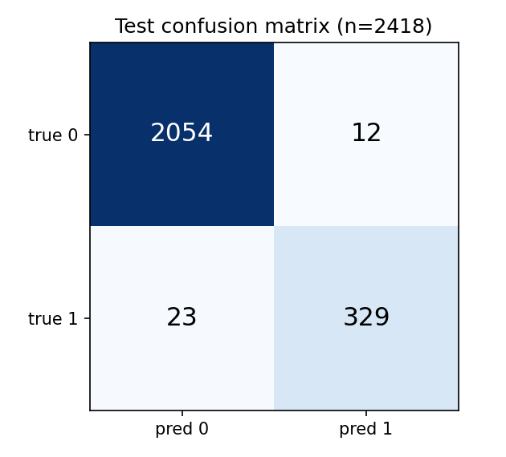
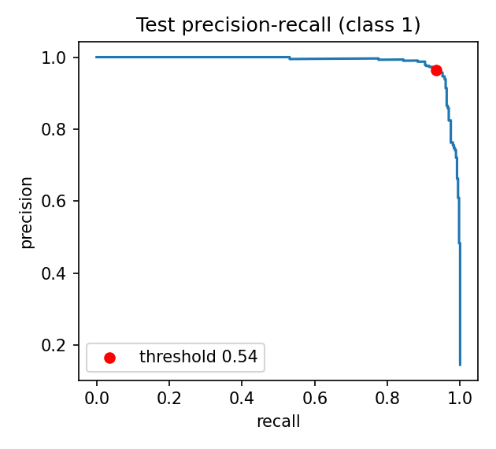

# Kazakh Profanity Detection in Product Reviews

DSSC5113 Algorithms of Computer Vision, Bonus Project (KBTU, Fall 2026), individual work.
Author: Shalkar Mukazhan, student ID 25MD0213.

## 1. Task

Input: one Kazakh review or comment. Output: a binary label and a probability.

| label | meaning |
|---|---|
| 0 | no Kazakh profanity |
| 1 | Kazakh profanity present |

The model is character n-gram TF-IDF plus logistic regression, trained from scratch. The decision threshold (0.5355) was chosen on the validation set.

Result on the held-out test set (n = 2,418, of which 352 are profane):

| precision (class 1) | recall (class 1) | F1 (class 1) | TP / FP / FN / TN |
|---:|---:|---:|---|
| 0.965 | 0.935 | 0.950 | 329 / 12 / 23 / 2,054 |

On the product-review test, which has no real profane product reviews and therefore uses 65 synthetic ones, the result is much weaker (F1 0.807, section 5.2). Section 6 discusses the errors, section 7 the limits of both numbers, including the fact that the test set was evaluated three times during development.

## 2. Quick start (no retraining)

The trained model and all preprocessing are in `models/profanity_tfidf_logreg.joblib` (about 2 MB, committed to the repository). It contains the fitted TF-IDF vocabulary, the classifier, the threshold and the config. The normalisation code it calls is in `src/textnorm.py`. Use the pinned scikit-learn version, because joblib files depend on it.

```bash
git clone https://github.com/Shalkar-Mukazhan/kazakh-profanity-detection.git
cd kazakh-profanity-detection
python -m venv .venv && source .venv/bin/activate      # Windows: .venv\Scripts\activate
pip install -r requirements.txt

python -m src.predict "Сапасы қотақ, ақшама өкінемін" "Тауар сапасы нашар, қайтарып бердім." "qotaq tauar"
# 1 (PROFANITY)  p=0.749  thr=0.535  | Сапасы қотақ, ақшама өкінемін
# 0 (clean)      p=0.001  thr=0.535  | Тауар сапасы нашар, қайтарып бердім.
# 1 (PROFANITY)  p=1.000  thr=0.535  | qotaq tauar

python -m src.predict            # interactive: type a comment, press Enter, empty line quits
```

From Python or a notebook:

```python
from src.predict import predict, explain
predict("Курьер нағыз жәлеп екен")
# [{'text': 'Курьер нағыз жәлеп екен', 'label': 1, 'prob_profanity': 0.843, 'threshold': 0.5355}]
explain("Көтіңе тық мұндай сервисіңді!!!")   # normalised text and the n-grams that drove the score
```

`demo.ipynb` does the same and has a cell where you type your own text. It runs in a fresh Google Colab runtime: the first cell clones the repository and installs the requirements.

## 3. Data

### 3.1 Sources and access

| source | what it is | use | licence |
|---|---|---|---|
| KazSAnDRA (Yeshpanov and Varol, LREC-COLING 2024), GitHub `IS2AI/KazSAnDRA` | about 168k real Kazakh reviews with sentiment ratings: app stores (`appstore`), online marketplaces (`market`), 2GIS (`mapping`), a bookstore | all train/val/test examples | CC BY 4.0 |
| Kazakh Swear Words, HuggingFace `Rustem-Kaimolla/kazakh-swear-words` | 119 hand-written words and phrases, neutral and offensive | extra rows, training split only | MIT |
| `data/product_test_synthetic.csv` | 65 synthetic product reviews (35 profane, 30 clean), written by me | evaluation only | this repository |

No account or token is needed. `python -m src.download_data` downloads the files `01_pc_train_ib`, `04_pc_valid` and `05_pc_test` from the KazSAnDRA GitHub repository (the three files of its polarity-classification task) and treats them as one pool of 167,961 reviews. I re-split the pool myself because the original splits are made for sentiment, not for profanity, and know nothing about near-duplicates.

How the data relates to product reviews: the `market` domain (reviews of goods from Kazakh online shops) is real product-review text, and 4,368 of those reviews are in my sample. There is one gap that I could not close: none of the sampled `market` reviews contains profanity, probably because shops moderate reviews before publishing them. Real profane reviews exist almost only in app and game reviews. So the model learns profanity from app reviews, and I test product-review behaviour separately (section 5.2) with synthetic examples, which are marked as synthetic everywhere.

KazSAnDRA's own labels are sentiment (1 = positive, 0 = negative). They are not profanity labels. I did not use them as labels, only to sample clean reviews, so that angry reviews are well represented among the clean examples.

### 3.2 Labelling rules

A comment gets label 1 if it contains at least one obscene or vulgar word.

Counted as profanity:
* Kazakh obscene words: `қотақ` (and `қотақбас`, `қотағым`, `котоктар`), `тасақ`, `қаншық`, `жәлеп` and `жалаптар` as slurs, `ам` and `амы` as the vulgar word, the verb `сігу` in its obscene forms (`сігейін`, `сіктір`, `сігілген`), and `көт` as a vulgar word (see the rules below). The abbreviation `шшс` / `щщс` also counts.
* Mixed-language comments: Russian obscene roots inside a Kazakh comment count (`нахуй`, `пиздец`, `бля`, `сука`, `заебал`, `далбаёб`, `ебаит`). They are normal in Kazakh colloquial swearing and appear in the swear-word dataset. Comments written entirely in Russian are not the target and are almost absent from the data.
* Masked and misspelt words count as the word they hide: `қ*тақ`, `кот*к`, `sig*****p`, `за#!%#`, `qotaq`, `к о т а к`, `Қотаааақ`, `КОТАҚ`. The lexicon matches such masks (`src/lexicon.py: masked_hits`): a mask run of k characters may stand for k-2 to k+2 letters, and the visible letters must fit a known word.

Rules for `кот` / `көт` (these are my rules, set after I read all ambiguous reviews as a native speaker):
* `кот` as an SMS or verification code ("кот келмейді", "кот жіберші") is 0.
* `көтер-`, `котер-`, `көтеру` (to lift) and `көтерме` (wholesale) are 0.
* `көтені` in a diaper review (a baby's bottom, anatomical) is 0.
* `көт` as the rude word for "backside" (`көтің`, `көтіңе тық`, `көтіңді қыс`, `көті боқ`) is 1.
* The evaluative use of `кот` / `көт` ("кот ойын", "Kot oyin", "кот екен тартпандар", "көт ойын") is 1. All of these are labelled alike now; my first pass labelled "көт ойын" as 1 and "кот ойын" as 0, which was inconsistent.
* Exceptions stay 0 where the context shows another word: a cat ("ой май кот 😘"), a door code, a typo of "көтеру".

Counted as clean:
* Negative reviews without profanity. "Өте жаман дүкен, енді алмаймын!!!" is 0. A bad rating is not profanity.
* Mild insults and rude words that are not obscene: `ақымақ`, `мал`, `ешек`, `топас`, `қотыр`, `говно`, `боқ`. This is my design decision (see 3.3). The swear-word dataset lists some of these as `insult`; I relabelled them to 0.
* Words that only look like profanity: `сігісімді`, `сігіспей`, `сигандар`, `сигенін` / `сигеннен` (in diaper reviews), `әмин` / `амин` (Amen), `Ам` as a name, `қотыр` (scabies), `қотару` (to download), `сықырлайды` (squeaks), `сиқыр` (magic), `сигнал`, `Kotlin`, AM/PM, "I am".
* Cases that stay ambiguous after reading the context: label 0.

Examples (real KazSAnDRA reviews unless marked; contact data and names are masked or absent):

| text | label | why |
|---|---:|---|
| Тауар сапасы нашар, қайтарып бердім. (synthetic) | 0 | negative, clean |
| Кот келмейді ғой | 0 | `кот` = SMS code |
| Қатты сықырлайды екен, күндіз білінбейді. | 0 | `сықыр-` is "squeak", not `сік-` |
| Қотақбас ойын 😡 | 1 | `қотақбас` |
| Көт ойын | 1 | evaluative `көт` |
| Шешеңнің амы, реклама бере берме | 1 | `амы` as the vulgar word |
| Пиздес ойын ута алмайсың зайбал | 1 | Russian roots inside Kazakh |
| Шшс жеткізуге 10 күн кетті (synthetic) | 1 | abbreviation |

### 3.3 Labelling method, and why it is done this way

Nobody has labelled KazSAnDRA for profanity, and there are 168k reviews, so reading them all is impossible. The method has five steps (`src/lexicon.py`, `src/prepare_data.py`):

1. Find candidates with a lexicon of obscene roots, matched on a normalised form of the text. Unambiguous roots (`қотақ`, `пизд`, `бля`, `заебал`, ...) and masked forms give 2,190 reviews in the sample that are labelled 1 automatically. I read 100 random ones in an early version: about 95 were clearly profane and 5 were doubtful (two one-word "Kotak" reviews, "Котак тарифы", a quoted "котак деген", one Latin-script "sikti"). Roots that cause false matches (`сік-` also matches `сиқыр` and `сықыр`) are matched on a less aggressive form of the text.
2. Read the ambiguous candidates. Roots such as `кот/көт`, `ам`, `жалап`, `сіг-` also occur in innocent words. 462 reviews matched only these. They are labelled by hand in `data/labels/manual_review_ambiguous.csv` (columns: id, label, trigger, note). A human label always wins over the lexicon.
3. Reviews with no lexicon hit are labelled 0. This is the weak point of the method (section 7).
4. Second pass on training and validation data (after the first model): I listed the training and validation reviews where model and label disagreed most and read them. Many were profanity the lexicon had missed (`Зай бал`, `Шешенамы`, `наху`, `далбайов`, `блә`, `сіккір`). I added those forms to the lexicon and four single reviews to `data/labels/label_corrections.csv`.
5. Native-speaker review of the whole hand-label file (all 462 rows), done by me, Shalkar Mukazhan, after the first test evaluation. It found inconsistent labels for `кот/көт` and nine clear errors. 28 labels changed from 0 to 1: 19 through the `кот/көт` evaluative rule above and 9 explicit corrections ("кот*к не деген ойын", "Котоктар", "Bir sig*****p kalgan", "Сигилген", "Салем жалап", "бүл үйат көт", "Ам да көрінеді", "...әм блат", "...за#!%# уже"). The lexicon was extended so that it finds these masks and forms in the rest of the data (38 masked reviews in the pool, all of which I checked by eye).

Why a lexicon and not crowd labels or an existing toxicity dataset: I did not find a Kazakh profanity or toxicity dataset for reviews, and the task is about obscene words (a lexical property), which a lexicon can find reliably; a sentiment or toxicity label would mix in rudeness and anger, which this task explicitly separates from profanity. Why the model is still worth training: it has to handle spelling variants, new words and the context of the ambiguous roots, which a lexicon cannot decide.

### 3.4 Cleaning, duplicates, privacy and splits

* Personal data: URLs, e-mails, phone numbers and @mentions are replaced by `<url>`, `<email>`, `<phone>`, `<user>` before anything else. KazSAnDRA has no reviewer-name field. Review texts are free text and can contain a name (for example a courier's name in a thanks message), so I do not commit review texts: the repository holds ids, labels and groups, and `prepare_data.py` rebuilds the texts locally. The only review texts in the repository are the README examples and the short error lists in `results/`, where I masked a name by hand.
* Exact duplicates (same text after lower-casing and collapsing spaces) were removed: 167,961 reviews became 166,055. If copies had different labels, label 1 is kept.
* Near-duplicates ("Котакбаааас!!!" and "қотақбас") get the same group key (letters only, repeated letters collapsed). The split is done on groups, so a group is never divided between splits. `data/splits/stats.json` reports 0 groups in more than one split.
* Sampling: all 2,495 profane reviews, all hand-reviewed clean look-alikes, 8,000 clean reviews with negative sentiment and 6,000 with positive sentiment. Up to half of each clean sample comes from the `market` domain first, because it is the target domain. I oversample negative reviews on purpose: the model must learn that anger is not profanity. The positive rate is about 15%, higher than real life, which is why I report precision and recall instead of accuracy.
* The 107 rows from the swear-word dataset (48 profane) go to the training split only. They are hand-written words, not real comments.
* Split: each group is assigned to train, validation or test by a hash of the seed and the group key (70 / 15 / 15, seed 42). Rows are sampled with the same kind of hash. I use hashes instead of a shuffle because a change of a few labels then does not move reviews between splits; this made it possible to count exactly how many test labels my review changed (section 7). The split is not stratified, so the ratios are approximate.

| split | total | label 0 | label 1 |
|---|---:|---:|---:|
| train | 11,765 | 9,961 | 1,804 |
| validation | 2,572 | 2,185 | 387 |
| test | 2,418 | 2,066 | 352 |
| total | 16,755 | 14,212 | 2,543 |

Where the profane examples come from: appstore 2,480, bookstore 10, mapping 5, swear-word dataset 48, market 0.

## 4. Model

I use TF-IDF on character n-grams followed by logistic regression (`src/train.py`).

Why this model:
* Profanity here is mostly a property of word forms, and the same word is written in many ways: Cyrillic and Latin letters, `қ`/`к`, `ә`/`а`, stretched letters, long Kazakh suffixes (`қотақ-бас-тар-ың`). Character n-grams capture the shared fragments (`қотақ`, `шшс`, `пизд`) without a fixed word list. An unseen word still shares most n-grams with known words, and that is how unknown tokens are handled.
* The training set is small (1,804 profane examples). A linear model trains in seconds on a CPU, can be inspected (each n-gram has one weight, see `results/top_ngrams.csv`) and is easy to explain and change in a defense.
* It outputs a probability, so the threshold can be tuned for moderation.
* Alternative that I did not choose: fine-tuning a multilingual transformer (for example XLM-R). It would see context better, but it needs a GPU, hides its reasoning, and with labels that come from a lexicon it would partly relearn the lexicon. I list it as an improvement in section 6.

How text becomes model input (`src/textnorm.py: normalize`, which runs inside the saved pipeline):
1. mask URLs, e-mails, phone numbers and @mentions; lower-case;
2. join single letters separated by spaces or dots ("к о т а к", "қ.о.т.а.қ" become "котак", "қотақ");
3. remove masking symbols inside words ("б\*\*ть" becomes "бть");
4. transliterate words typed fully in Latin ("qotaq" becomes "қотақ", "shshs" becomes "шшс"); fold Latin look-alike letters inside Cyrillic words;
5. shorten runs of 3 or more identical characters to 2 ("ааааа" becomes "аа").

Other punctuation and digits stay in the text, because "!!!" or digits can carry some signal. Long comments need no truncation: TF-IDF works at any length (the longest comment is about 1,900 characters). The price is dilution: one swear word in a long review gets a small weight after L2 normalisation (section 6). Unknown words are handled by the n-grams above; n-grams seen in fewer than 2 training reviews are dropped (`min_df = 2`). The model sees no lexicon: the lexicon is used only to label data.

The vectoriser is fitted on the training split only (vocabulary 33,277 n-grams). Classifier: logistic regression with L2 penalty, `class_weight="balanced"` (to compensate the 1:5.5 class imbalance in training) and the `liblinear` solver.

Model selection on the validation set only (`results/validation.json`):
* Grid: n-gram range {1-4, 2-5} and C in {0.5, 1, 2, 4, 8, 16, 32, 64}. For each setting the threshold that maximises validation F1 is found.
* Settings within 0.001 of the best validation F1 count as tied; among them I take the simplest (smallest C, then the smaller n-gram range). Here the best setting is alone in that band: n-grams 1-4, C = 64, threshold 0.5355, validation F1 = 0.958. C = 64 is the last value of the grid, so a larger C was not tried; the curve is nearly flat from C = 16 (0.955).
* Version history: the first version (before the native-speaker review and the new split method) was C = 16, n-grams 2-5, validation F1 0.956. Both validation sets are different samples, so these numbers are not directly comparable.

| item | value |
|---|---|
| Python | 3.13 |
| packages | `requirements.txt` (numpy 2.1.3, pandas 2.2.3, scikit-learn 1.6.1, joblib 1.4.2, matplotlib 3.10.0) |
| random seed | 42 (sampling, split, classifier) |
| features | `char_wb` n-grams 1-4, `min_df` 2, sublinear TF, up to 200k features |
| classifier | logistic regression, L2, C = 64, balanced class weights |
| threshold | 0.5355 |

### 4.1 Reproduce the training

```bash
pip install -r requirements.txt
./run_all.sh     # = download_data, prepare_data, train, evaluate
```

The steps can also be run separately: `python -m src.download_data`, `python -m src.prepare_data`, `python -m src.train`, `python -m src.evaluate`. The whole pipeline takes a few minutes on a laptop CPU. All settings and the seed are in `config.json`. `src.evaluate` is meant to be run once, after the settings are fixed.

## 5. Results

All numbers are in `results/test_metrics.json`.

### 5.1 Held-out test set

n = 2,418 (352 profane, 2,066 clean), threshold 0.5355.

| class 1 (profanity) | value |
|---|---:|
| precision | 0.965 |
| recall | 0.935 |
| F1 | 0.950 |
| average precision (PR-AUC) | 0.986 |

|  | predicted 0 | predicted 1 |
|---|---:|---:|
| true 0 | TN = 2,054 | FP = 12 |
| true 1 | FN = 23 | TP = 329 |

 

By label origin: clean reviews with no lexicon hit are classified correctly 99.7% of the time, lexicon-labelled profanity 95.3%, and the hand-labelled ambiguous reviews (`кот`, `көт`, `ам`, ...) only 78.7% (n = 61). By domain: the 631 `market` test reviews contain no profanity and the model has no error on them; all 12 false positives and 22 of 23 false negatives are in app reviews.

### 5.2 Product-review test

Test set for the task as stated: the 631 real clean `market` reviews of the test split plus 65 synthetic product reviews (`data/product_test_synthetic.csv`, 35 profane, 30 clean). The synthetic reviews were written before the first model was trained and were not used for any decision.

| set | n | precision | recall | F1 | FP | FN |
|---|---:|---:|---:|---:|---:|---:|
| synthetic only | 65 | 0.926 | 0.714 | 0.807 | 2 | 10 |
| synthetic + real market | 696 | 0.926 | 0.714 | 0.807 | 2 | 10 |

By type of synthetic review: Latin script (2 of 2), CAPS, stretched letters, spaced letters and the mixed example are correct; Russian roots 10 of 11; plain Kazakh profanity only 7 of 13; the abbreviation `шшс` 1 of 2; both star-masked examples ("Қ\*тақ", "Б\*\*ть") are missed (p = 0.03 and 0.04). Of the 30 clean reviews, 28 are correct. The two false positives are "Көтерме баға өте тиімді" (wholesale price, p = 0.83) and "Котлин курсы өте пайдалы" (p = 0.61): the character n-grams `көт` and `кот` are now strongly tied to profanity. The first model of this project (before the review, section 7) got all 30 clean synthetic reviews right and recall 0.83 on the profane ones, so the review rules and the new split made this test worse.

## 6. Errors and what they mean for moderation

A false positive is a clean review that the model flags: an honest customer's review is hidden or delayed. A false negative is a profane review that gets through: obscene text appears on a product page. Both cost something, but they cost different people. For an online shop I would accept some false positives (a moderator can release a flagged review in seconds) and treat false negatives as the worse error, because customers and the shop see them directly. A practical setup uses the probability: hide automatically above about 0.9, send the band between about 0.3 and 0.9 to a human moderator, publish the rest. Raising or lowering the threshold trades precision for recall; the PR curve shows how.

The 35 test errors (12 FP, 23 FN) are in `results/test_errors.csv`. Four groups, with likely causes and fixes:

1. Several "false positives" are missing labels, not model mistakes. "Бүйткен тик тогнды сгин" (p = 0.83) and "...жогалт мааал былай сены сыгем" (0.70) contain the obscene verb in a spelling that my lexicon does not cover, so they were labelled 0. So the precision of 0.965 is probably a little too low; I cannot say by how much without relabelling the test set, and doing it after seeing these errors would be tuning on the test set. Other false positives are mild words near the border of my rules ("Өте далбан", p = 1.00; "Мал тупой шешен", 0.96). Fix: more than one annotator, and use the model's high-probability "clean" reviews to find missed spelling variants.
2. The `кот` / `көт` ambiguity, which my labelling rules made harder. "Кот келмеді 😰" (0.54) and "...кот сурап кот дым келмеді" (0.57) are SMS-code complaints, labelled 0 and flagged, while "Кот керемет өзі" (0.41) and "Кап кутпен кот кинаганша..." (0.06) are labelled 1 under the evaluative rule and missed. The same letters now mean "code" in one sentence and "vulgarity" in the next, and character n-grams cannot see the difference. In the synthetic test the same effect flags "Көтерме баға" (0.83). The hand-labelled ambiguous reviews are the weakest part (78.7% correct). Fix: many more hand-labelled examples of `көтер-`, `кот` + code words and `Kotlin` as negatives (hard negatives), or a contextual model such as a fine-tuned XLM-R.
3. Masked words and rare spellings (false negatives). "Бл\*\*\*, не мынау" (0.05), "на$%$%%" (0.12), "В п\*зду ... с\*гейін" (0.03) are found by the lexicon but not by the model: after normalisation they read "бл\*\*", "на$%$%%" and "пзду" / "сгейін" (letters missing), short forms that the model saw rarely in training. The Latin-script "Jana nuskasi sikti desek..." (0.06) and "Қ\*тақ" in the synthetic test (0.03) show the same weakness. Fix: treat `*` as a wildcard against the lexicon at inference time, or train on masked copies (I did not try it in this version).
4. One swear word inside a long review (false negatives). "...оте керемет ойын ... ебайт ойын болушы еди..." (0.03), "Кереметкое соз жок тфа тфа сучка менин" (0.01) and a long review of a car game that contains one profane word among a list of car names (0.06): with L2-normalised TF-IDF a single bad word gets a small weight in a long text. Fix: score sentence by sentence (or in sliding windows) and flag the comment if any part is profane.

## 7. Limitations

* Labels come from a lexicon plus hand reading of ambiguous hits, so test metrics partly measure agreement with that lexicon. Profanity the lexicon never matches was labelled 0 unless I found it during the second pass; the false positives in section 6 show that this still happens in the test set.
* There is no real profane product review in the public data (zero in the `market` sample), so the product-review test uses synthetic profane examples that I wrote. My synthetic examples use words I knew were in the lexicon, so that test is, if anything, optimistic, and still gives F1 0.807.
* The test set was evaluated three times. Round 1 (labels before the native-speaker review, a shuffled split): n = 2,490, precision 0.924, recall 0.964, F1 0.944; files in `results/v1_before_review/`. Round 2 (after the review corrections, still with the shuffled split, which moved almost all reviews between splits): n = 2,497, F1 0.953. Round 3 (final, with the hash split that keeps splits stable): n = 2,418, F1 0.950. I did not change the model type, the grid or the threshold rule because of a test result; the changes between rounds were to labels, to the lexicon and to the split algorithm. Still, three looks at the test set mean that the final number is not a clean single evaluation, and the rounds use different test samples, so they cannot be compared one to one.
* Labels I corrected by hand: the native-speaker review changed 28 labels (all 0 to 1). The final split has 7 of them in the test set ("pla001500", "pla010988", "pla017089", "pla069265", "pla081404", "pla112843", "pla134016"), 13 in train, 7 in validation, and 1 review is not in the sample. In addition 8 test reviews are labelled 1 only because the lexicon now recognises masks (`бл*`, `с*гейін`, `на$%$%%` and similar). The review was done by reading the whole hand-label file, not by looking at model predictions, and the corrected labels were fixed before the final training and evaluation. It happened after the first test evaluation, however, so it is not independent of what I had already seen: some of the corrected reviews (for example "Ам да көрінеді") were also model errors in round 1. The corrections did not make the test score look better: 3 of the 7 corrected test labels are now false negatives ("pla001500", "pla010988", "pla134016").
* One annotator for the labels (me, with AI assistance for the first draft), and no measure of agreement between annotators. The rules "mild insults and `говно`/`боқ` are clean", "Russian roots inside Kazakh text are profane" and the `кот/көт` rules are my design choices; another annotator could decide differently.
* The best C is at the edge of the grid (64), so the selection may not be optimal, though the validation curve is nearly flat.
* Validation F1 (0.958) and test F1 (0.950) are close, but both rest on a few hundred positives, so differences of one or two points are within noise. The synthetic test has only 35 profane reviews, so its numbers move by several points when one or two reviews change.
* The model detects obscene words, not meaning. Insults without obscene words, sarcasm and threats are out of scope.

## 8. Repository layout

```
config.json                      settings and seed
requirements.txt                 pinned versions
run_all.sh                       full reproduction
demo.ipynb                       load model, type your own comment (Colab-ready)
src/textnorm.py                  normalisation, skeleton form, duplicate keys
src/lexicon.py                   obscene-root lexicon (labelling only), masked-word matcher
src/download_data.py             downloads KazSAnDRA and the swear-word dataset
src/prepare_data.py              labelling, sampling, deduplication, hash split
src/train.py                     model, settings and threshold selection on validation
src/evaluate.py                  one test evaluation, plots, errors, top n-grams
src/predict.py                   predict() and explain(), command line
data/labels/manual_review_ambiguous.csv   my hand labels for the 462 ambiguous reviews
data/labels/label_corrections.csv         four corrections from the second pass
data/product_test_synthetic.csv           65 synthetic product reviews (evaluation only)
data/splits/                     ids, labels and groups per split, stats.json
models/profanity_tfidf_logreg.joblib      trained model, preprocessing, threshold
results/                         final metrics, plots, predictions, errors, top n-grams
results/v1_before_review/        test results of round 1 (before the native-speaker review)
```

## 9. AI assistance and my own contribution

AI assistant used: Claude (Anthropic) through Claude Code. It wrote the first version of the code in `src/`, drafted the lexicon, the synthetic product reviews and this README, proposed the first labels for the ambiguous reviews, suggested the second labelling pass, and made the code changes after my review (lexicon masks and forms, hash split, rebuilding and re-evaluating the model).

My own work: I checked the disputed labels myself. I read all 462 rows of `data/labels/manual_review_ambiguous.csv` as a native speaker of Kazakh, found the inconsistent and wrong labels, and corrected them; the rules for `кот` / `көт` (section 3.2) are mine. I also fixed the labelling rules, the task setup and the decision to treat mild insults as clean, ran the pipeline, and did the error analysis.

## Data citation

Yeshpanov, R., Varol, H. A. KazSAnDRA: Kazakh Sentiment Analysis Dataset of Reviews and Attitudes. LREC-COLING 2024. https://github.com/IS2AI/KazSAnDRA (CC BY 4.0).
Kazakh Swear Words dataset: https://huggingface.co/datasets/Rustem-Kaimolla/kazakh-swear-words (MIT).
